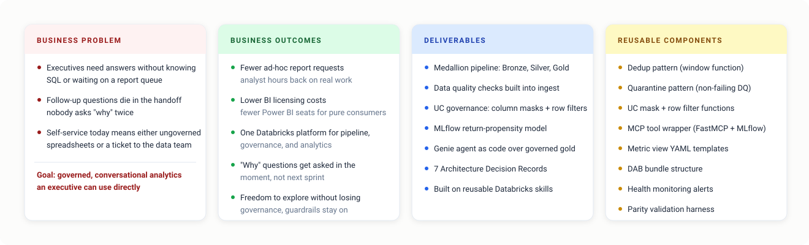
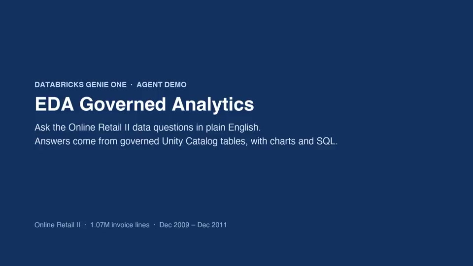

Executives ask questions in plain English and get answers from governed data: no SQL, no report queue, no loosened guardrails. Deterministic medallion pipelines and Unity Catalog enforcement keep every number trustworthy; Genie AI/BI makes them conversational.

---

## What This Demonstrates



This is a production-oriented Databricks lakehouse reference implementation for governed retail analytics and AI-assisted self-service. The design deliberately separates deterministic controls (ingestion, deduplication, data quality, metric calculation, access enforcement, auditability) from probabilistic capabilities (predictive modeling, natural-language question interpretation).

---

## Quick Start

```bash
just                  # Show all commands
just validate         # Python + JSON + YAML + docs + DAB
just health           # Run health checks against workspace
just ask "..."        # Ask Genie a question
just dab              # Full cycle: validate, deploy, run
```

| Command | What it does |
|:---|:---|
| `just validate` | Validate Python syntax, JSON, YAML, docs, DAB config |
| `just health` | Run 8 health checks against live Databricks workspace |
| `just ask "..."` | Ask the Genie agent a natural-language question |
| `just dab` | Full cycle: validate, deploy, run pipeline |
| `just deploy-genie` | Deploy Genie space definition |
| `just metric-views` | Deploy metric views to Unity Catalog |
| `just preview` | Open executive presentation in browser |
| `just demo` | Play the Genie demo video |

---

## Demo: Genie Agent (36 s)

[](https://github.com/slysik/databricks-eda/raw/main/demo/genie_agent_demo.mp4)

*Click the image to watch. The EDA Governed Analytics Genie agent answers business questions with charts and SQL, from governed Unity Catalog tables.*

---

## System Architecture


---

## High Level: Medallion to Genie

| Layer | Notebook | What It Does |
|:---|:---|:---|
| **Source** | UC table | `retail_source.online_retail.transactions_raw` (1.07M rows) |
| **Bronze** | `01_bronze_ingest.py` | Ingest from UC source. Dedup on 7-column key (pragmatic deviation: source has baked-in overlap). Idempotent overwrite. |
| **Silver** | `02_silver_clean.py` | 6-class line categorization, CHECK constraints, quarantine, guest identity stitching. |
| **Gold** | `03_gold_aggregate.py` | Daily KPIs + customer RFM/LTV features. Pre-aggregated for sub-second queries. |
| **Governance** | `04_governance.py` | UC column mask (customer_id), row filter (UK-only). Genie inherits automatically. |
| **Metric Views** | `src/metrics/*.sql` | 3 governed views with MEASURE() syntax. Single source of truth for KPIs. |
| **Genie** | `05_genie_agent.py` | Agent config as code: tables, instructions, example SQL. Asks questions in plain English. |
| **ML Model** | Notebook (not served) | Random Forest return propensity, 0.8899 ROC-AUC. Registered in UC, not wired into MCP. |

---

## Executive Summary

Analyzing 1.07M raw transaction line items from a UK-based online gift retailer (Dec 2009 - Dec 2011).

* **Headline Top-Line (+1.2% YoY):** Flat top-line growth hides two opposing dynamics:
  * **Identified Wholesale Accounts:** Fell **-2.8%** (units purchased dropped 10.8%, partially offset by higher ticket value per unit).
  * **Anonymous / Dotcom Web Channel:** Grew **+32.1%** and accounts for 100% of the retailer's net growth.
* **Volume Concentration & Seasonality:**
  * Top 10% of customer accounts generate **63.2%** of revenue.
  * Q4 holiday rush (Sep-Nov) accounts for **~38%** of annual revenue.
  * Export markets heavily concentrated in single corporate wholesale accounts (e.g., Netherlands = 1 customer driving 96% of sales).
* **Data Traps Discovered & Neutralized:**
  * **Sheet Overlap (1-9 Dec 2010):** 22,523 rows (~GBP 377k) were duplicated across annual sheets, inflating previously published Kaggle benchmarks.
  * **Cancellation Linkage:** Disentangled true returns (`C` prefix) from accounting adjustments (`A` prefix) and admin write-offs.

### Key Financials (Dual-Engine Parity Verified)

| Metric | PySpark | Spark SQL | Parity Status |
| :--- | :--- | :--- | :---: |
| **Gross Sales** | GBP 20,317,406.03 | GBP 20,317,406.03 | **PASS (Diff = 0.00)** |
| **Refunds & Cancellations** | GBP 1,462,424.18 | GBP 1,462,424.18 | **PASS (Diff = 0.00)** |
| **Net Revenue** | GBP 18,854,981.85 | GBP 18,854,981.85 | **PASS (Diff = 0.00)** |
| **Active Customer Accounts** | 5,942 | 5,942 | **PASS (Diff = 0.00)** |
| **Guest Checkout Share** | 16.3% | 16.3% | **PASS (Diff = 0.00)** |
| **Cleaned Line Items** | 1,033,034 | 1,033,034 | **PASS (Diff = 0.00)** |

---

**Live Genie agent:** [EDA Governed Gold Analytics](https://dbc-61514402-8451.cloud.databricks.com/genie/rooms/01f1be9f6999187ea0956f86f5fe7e9b?o=7474656067656578) (workspace access required) | config: [`genie/space_config.json`](genie/space_config.json)

### Key Technical Capabilities

1. **Dual-Engine Mathematical Parity:** Every analytical figure and KPI is implemented in two independent engines (PySpark DataFrame API and Spark SQL dialect), then programmatically evaluated against a zero-tolerance assertion harness.
2. **Bronze Ingestion from Unity Catalog:** `src/01_bronze_ingest.py` reads from the existing UC source table via `spark.table()`. Window-function dedup removes 22,523 overlap rows.
3. **Deterministic Data Quality & Quarantine:** Delta `CHECK` constraints (`price >= 0`, `invoice_date IS NOT NULL`). Non-inventory codes isolated to quarantine.
4. **Customer Identity Stitching:** SHA-256 heuristic resolves guest checkouts via invoice + country + date.
5. **MLflow Model (trained, not served):** Random Forest Return Propensity, 0.8899 ROC-AUC, registered in UC. MCP tool uses rule-based heuristic today.
6. **Unity Catalog Governance:** Dynamic column masks + row-level security. Genie inherits automatically.
7. **Unity Catalog Metric Views:** Three governed views (`daily_kpis`, `customer_features`, `sales_by_country`) with `MEASURE()` syntax.

---

## Health Monitoring


| Alert | Check | Trigger |
|:---|:---|:---|
| Pipeline Health | Job ran in last 24h? | No successful run |
| Data Freshness | Gold tables current? | Latest date > 24h old |
| Quarantine Rate | Data quality | Rate > 15% |
| Row Count Stability | Silver rows | Deviation > 10% |
| Metric View Health | Views queryable? | Any view returns 0 rows |

Deployed via `just dab-deploy`. Emails `lysiak043@gmail.com` on failure.

---

## Documentation

| Document | Purpose |
|:---|:---|
| [`PRODUCTION_READINESS.md`](PRODUCTION_READINESS.md) | Gap analysis: implemented vs. required for production |
| [`OPERATIONS.md`](OPERATIONS.md) | Health signals, monitoring, incident response |
| [`DEPLOYMENT.md`](DEPLOYMENT.md) | Deployment commands, validation, rollback |
| [`docs/adr/`](docs/adr/) | Architecture Decision Records (7 ADRs) |

---

## Interviewer's Quick Start

1. **Business context:** UK online gift retailer, 1.07M transactions (Dec 2009 - Dec 2011). Separate real growth from data traps, build trusted metrics, enable governed self-service.
2. **Architecture:** Medallion (Bronze -> Silver -> Gold) with UC governance, MLflow model training (registered but not served), Genie NL analytics. See diagram above.
3. **Key insight:** Dual-engine parity (PySpark + Spark SQL) with zero-tolerance assertions. Every headline metric independently verified.
4. **Medallion to Genie:** Each layer has a clear job. Ingestion, quality, metrics, governance are deterministic SQL. ML model is trained but not served. Genie makes it conversational.
5. **Production readiness:** See [`PRODUCTION_READINESS.md`](PRODUCTION_READINESS.md) for honest gap analysis.
