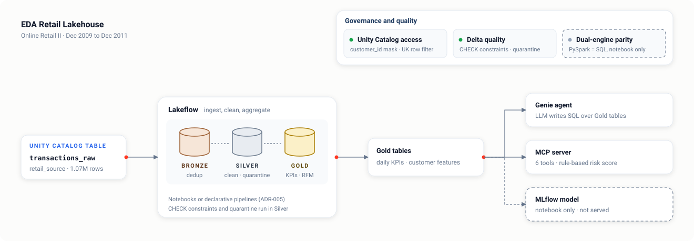

# Databricks EDA & Lakehouse Production Blueprint
### Online Retail II Transaction Analysis & Architecture

A dual-engine (**PySpark + Spark SQL**) exploratory data analysis with programmatic parity verification, extending to an enterprise Lakehouse blueprint featuring Gold medallion aggregates, MLflow predictive modeling, Unity Catalog governance, and Genie AI/BI self-service analytics.

---

## What This Demonstrates

This is a production-oriented Databricks lakehouse reference implementation for governed retail analytics and AI-assisted self-service.

It transforms raw retail transactions into trusted Bronze, Silver, and Gold data products, validates core metrics through independent PySpark and Spark SQL implementations, applies Unity Catalog governance, trains and registers a return-propensity model with MLflow, and enables natural-language analytics through Databricks Genie.

The design deliberately separates deterministic controls—ingestion, deduplication, data quality, metric calculation, access enforcement, and auditability—from probabilistic capabilities such as predictive modeling and natural-language question interpretation.

---

## System Architecture



*For a dark-theme variant, see [`assets/architecture-dark.svg`](assets/architecture-dark.svg). For a detailed annotated Mermaid version with cross-cutting controls, see [`assets/architecture_diagram.md`](assets/architecture_diagram.md).*

---

## Deterministic vs. Probabilistic

| Capability | Type | Mechanism | Confidence |
|:---|:---:|:---|:---:|
| Bronze ingestion & deduplication | **Deterministic** | Window function + idempotent overwrite | Exact |
| Line categorization (6 classes) | **Deterministic** | Rule-based classification (prefixes, stock codes, quantity sign) | Exact |
| Data quality constraints | **Deterministic** | Delta `CHECK` constraints (`price >= 0`, `invoice_date IS NOT NULL`) | Exact |
| Metric calculation (KPIs, RFM) | **Deterministic** | SQL / DataFrame aggregation with dual-engine parity validation | Exact (0.00 diff) |
| Customer identity stitching | **Deterministic** | SHA-256 hash of invoice + country + date for guest resolution | Exact per rule |
| Column masking & row filtering | **Deterministic** | UC dynamic masking + row filters via `IS_ACCOUNT_GROUP_MEMBER()` | Exact |
| Return propensity model (RF) | **Probabilistic (trained, not served)** | MLflow Random Forest classifier, 0.8899 ROC-AUC — registered in UC but not wired into MCP tool | 89% AUC |
| Genie NL interpretation | **Probabilistic** | Databricks Genie (LLM + governed SQL) | Model-dependent |
| MCP `predict_return_risk` | **Deterministic (today)** | Rule-based heuristic (return history, order value, quantity). RF model trained but not wired in. | Advisory |

---

## Demo: EDA Genie Agent (36 s)

[▶ Watch the Genie Agent demo (MP4)](https://github.com/slysik/databricks-eda/raw/main/demo/genie_agent_demo.mp4)

*The **EDA Governed Analytics** Genie agent answers two business questions with charts and SQL, from governed Unity Catalog tables.*

---

## Executive Summary

Analyzing 1.07M raw transaction line items from a UK-based online gift retailer (Dec 2009 – Dec 2011). 

* **Headline Top-Line (+1.2% YoY):** Flat top-line growth hides two opposing dynamics:
  * **Identified Wholesale Accounts:** Fell **−2.8%** (units purchased dropped 10.8%, partially offset by higher ticket value per unit).
  * **Anonymous / Dotcom Web Channel:** Grew **+32.1%** and accounts for 100% of the retailer's net growth.
* **Volume Concentration & Seasonality:** 
  * Top 10% of customer accounts generate **63.2%** of revenue.
  * Q4 holiday rush (Sep–Nov) accounts for **~38%** of annual revenue.
  * Export markets are heavily concentrated in single corporate wholesale accounts (e.g., Netherlands = 1 customer driving 96% of sales).
* **Data Traps Discovered & Neutralized:**
  * **Sheet Overlap (1–9 Dec 2010):** 22,523 rows (~GBP 377k) were duplicated across annual sheets, inflating previously published Kaggle benchmarks.
  * **Cancellation Linkage:** Disentangled true returns (`C` prefix) from accounting adjustments (`A` prefix) and admin write-offs.

### Key Financials (Dual-Engine Parity Verified)

| Metric | PySpark | Spark SQL | Parity Status |
| :--- | :--- | :--- | :---: |
| **Gross Sales** | GBP 20,317,406.03 | GBP 20,317,406.03 | **PASS (Diff = 0.00)** |
| **Refunds & Cancellations** | GBP 1,462,424.18 | GBP 1,462,424.18 | **PASS (Diff = 0.00)** |
| **Net Revenue** | GBP 18,854,981.85 | GBP 18,854,981.85 | **PASS (Diff = 0.00)** |
| **Active Customer Accounts** | 5,942 | 5,942 | **PASS (Diff = 0.00)** |
| **Guest Checkout Share** | 16.3% | 16.3% | **PASS (Diff = 0.00)** |
| **Cleaned Line Items** | 1,033,034 | 1,033,034 | **PASS (Diff = 0.00)** |

---

**Live Genie agent:** [EDA Governed Gold Analytics](https://dbc-61514402-8451.cloud.databricks.com/genie/rooms/01f1be9f6999187ea0956f86f5fe7e9b?o=7474656067656578) (workspace access required) · definition in [`genie/space_config.json`](genie/space_config.json)


### Key Technical Capabilities

1. **Dual-Engine Mathematical Parity:**
   Every analytical figure and KPI is implemented in two independent engines (PySpark DataFrame API and Spark SQL dialect), then programmatically evaluated against a zero-tolerance assertion harness.
2. **Bronze Ingestion from Unity Catalog (not file-based):**
   `src/01_bronze_ingest.py` reads the source rows directly from the existing `retail_source.online_retail.transactions_raw` UC table via `spark.table()` — there is no Excel/Volume file read or Auto Loader step. A window-function dedup (partitioned on invoice, SKU, timestamp, qty, price, customer, country) removes the 22,523-row sheet overlap, and the result is written `overwrite` to `{catalog}.bronze.transactions_raw` for idempotent re-runs.
3. **Deterministic Data Quality & Quarantine:**
   Delta `CHECK` constraints prevent fatal anomalies (`price >= 0`, `invoice_date IS NOT NULL`), while non-inventory service codes (`POST`, `D`, `BANK CHARGES`, `AMAZONFEE`) are isolated into an audit quarantine table without breaking ingestion pipelines.
4. **Customer Identity Stitching:**
   Heuristic attribution resolves unauthenticated guest checkouts by linking invoice temporal locality, country metadata, and order velocity to recover fractured customer journeys.
5. **Predictive Machine Learning (MLflow + UC):**
   A Random Forest Return Propensity classifier trained on RFM features achieves **0.8899 ROC-AUC**, fully logged with parameters and artifacts, and registered to Unity Catalog as `retail_prod.gold.return_propensity_model`.
6. **Unity Catalog Dynamic Governance:**
   Dynamic column masks (`MASK()` user-defined function) mask `customer_id` into `***MASKED***` for non-administrative roles while preserving complete operational utility.
7. **Unity Catalog Metric Views:**
   Three governed metric views (`daily_kpis`, `customer_features`, `sales_by_country`) define business metrics declaratively in YAML. Genie, dashboards, and SQL consumers share the same metric definitions via `MEASURE()` syntax. Benchmarked with ~13% overhead vs direct queries (negligible at this scale).

---

## Deliverables & Repository Layout

| File | Description |
| :--- | :--- |
| **`README.md`** | **This file:** Architecture narrative, executive summary, quickstart, and interviewer guide. |
| **`PRODUCTION_READINESS.md`** | **Production Readiness Assessment:** Gap analysis of implemented vs. required capabilities for real production launch. |
| **`OPERATIONS.md`** | **Operations Runbook:** Health signals, monitoring, alerting, incident response, and ownership. |
| **`DEPLOYMENT.md`** | **Deployment Guide:** Tested commands for DAB deployment, validation, and rollback. |
| **`docs/adr/`** | **Architecture Decision Records:** Rationale for major technical choices (Medallion, dual-engine, UC governance, etc.). |
| **`src/01_bronze_ingest.py`** | **Bronze Ingestion:** Window-based dedup from UC source table, idempotent overwrite. |
| **`src/02_silver_clean.py`** | **Silver Cleaning:** 6-class line categorization, Delta CHECK constraints, quarantine, identity stitching. |
| **`src/03_gold_aggregate.py`** | **Gold Aggregation:** Daily KPIs + Customer RFM/LTV features (pre-aggregated for sub-second BI). |
| **`src/04_governance.py`** | **Unity Catalog Governance:** Dynamic column masking + row-level security. |
| **`src/05_genie_agent.py`** | **Genie Agent Config:** Space definition with governed tables, instructions, sample questions. |
| **`src/metrics/`** | **Unity Catalog Metric Views:** Declarative YAML metric definitions (daily_kpis, customer_features, sales_by_country) for governed Genie + BI consumption. |
| **`src/pipelines/retail_sdp/`** | **Spark Declarative Pipeline:** Declarative implementation of the same medallion flow. |
| **`mcp-retail-server/`** | **Purpose-built MCP server:** 6 tools shaped to executive questions (KPIs, segments, period compares, revenue breakdown, DQ check, return-risk prediction) — not a raw SQL passthrough. FastMCP pure functions, UC-secured service principal, MLflow traces on every call. |
| **`genie/space_config.json`** | **Genie Agent as Code:** Exported definition of the *EDA Governed Gold Analytics* space (used by `deploy_genie.py`). |
| **`genie/ask_genie.py`** | **Genie CLI:** Ask the live Genie One Agent a plain-English question from the terminal. |
| **`genie/deploy_genie.py`** | **Genie Deploy:** Create or update the Genie Space definition via the Databricks SDK. |
| **`eda_online_retail_ii_presentation.html`** | **Executive Presentation:** Standalone single-file HTML presentation (recompile via `just build`). |
| **`demo/genie_agent_demo.mp4`** | **Genie Agent Demo Video:** 36-second captioned walkthrough of the agent answering questions with charts and SQL. |
| **`assets/architecture-light.svg`** | **Architecture Diagram:** Token-driven SVG showing source → Bronze → Silver → Gold → serving, with governance and honest "not served" disclosure on the MLflow card. |
| **`genie_one_eda.png`** | **Genie AI/BI Live Verification:** Screenshot of Databricks Genie Agent answering guest checkout revenue distribution over Gold tables (used in presentation build). |
| **`build_presentation.py`** | **Report Compiler:** Builds the presentation directly from notebook execution models, ensuring report-to-code alignment. |
| **`databricks.yml`** | **Databricks Asset Bundle:** Declarative deployment of notebooks, SDP pipeline, and scheduled job. |
| **`Justfile`** | **Command Runner:** One-command developer & review workflows (`just preview`, `just demo`, `just build`, `just ask`). |

---

## Quickstart

### 1. Open in Databricks
This repo is linked as a Databricks **Git folder** at `/Workspace/Users/<you>/databricks-eda` (Workspace → Create → Git folder → `https://github.com/slysik/databricks-eda`). Or import a single notebook:

1. In your Databricks workspace, navigate to **Workspace**.
2. Click **Import** &rarr; select **`eda-online-retail-gold-V1-2026-10-02 17_48_41.ipynb`**.
3. Attach to any **Serverless Compute** or standard cluster (DBR 14.3+).
4. Run all cells or view in **Results only** mode for clean presentation display.

### 2. Local Quick Commands (`just`)
If you have [`just`](https://github.com/casey/just) installed:
```bash
just preview    # Open executive HTML presentation in your default browser
just demo       # Play the 36-second Genie Agent demo video
just notebook   # Open the full executed notebook in your browser
just build      # Recompile presentation from notebook run export
just check      # Validate Python and JSON schemas
just ask "What percentage of revenue comes from guest checkouts?"
```

### 3. Run Presentation Compiler Manually
The analytical HTML presentation can also be recompiled directly via `uv`:
```bash
uv run --with markdown python build_presentation.py "eda-online-retail-gold-V1-2026-10-02 17_48_41.html" eda_online_retail_ii_presentation.html
```

---

## Strategic Recommendations

1. **Formalize the Dotcom Channel:** Transition unauthenticated web orders to a dedicated digital brand journey with persistent guest sessions and targeted email recapture.
2. **Mitigate Account Concentration Risk:** Implement proactive account retention monitoring for top wholesale accounts (top 1% drive 34% of volume).
3. **Automate High-Risk Return Intervention:** Deploy the registered `return_propensity_model` to flag high-probability returns (>15% risk) in real time during checkout.

---

## Documentation

| Document | Purpose |
|:---|:---|
| [`PRODUCTION_READINESS.md`](PRODUCTION_READINESS.md) | What is implemented, demonstrated, and needed before a real production launch |
| [`OPERATIONS.md`](OPERATIONS.md) | Service health signals, monitoring, alerting, and operational ownership |
| [`DEPLOYMENT.md`](DEPLOYMENT.md) | Step-by-step deployment commands, validation, and rollback procedures |
| [`docs/adr/`](docs/adr/) | Architecture Decision Records for key technical choices |
| [`assets/architecture_diagram.md`](assets/architecture_diagram.md) | Full annotated Mermaid architecture diagram |

---

## Interviewer's Quick Start

New here? This is a 5-minute orientation:

1. **Business context:** A UK online gift retailer with 1.07M transactions (Dec 2009–Dec 2011). The challenge: separate real growth signals from data traps, build trusted metrics, and enable self-service analytics with governance.
2. **Architecture:** Medallion (Bronze → Silver → Gold) with Unity Catalog governance, MLflow model training (registered but not served), and Genie NL analytics. See the diagram above.
3. **Key insight:** Dual-engine parity (PySpark + Spark SQL) with zero-tolerance assertions ensures every headline metric is independently verified. See the parity table in the Executive Summary.
4. **What's deterministic vs. probabilistic:** Deterministic controls handle ingestion, quality, metrics, and governance. Probabilistic capabilities (ML model, Genie) handle prediction and natural-language interpretation. See the table above.
5. **Production readiness:** See [`PRODUCTION_READINESS.md`](PRODUCTION_READINESS.md) for a gap analysis of what is implemented versus what a real production launch would require.
