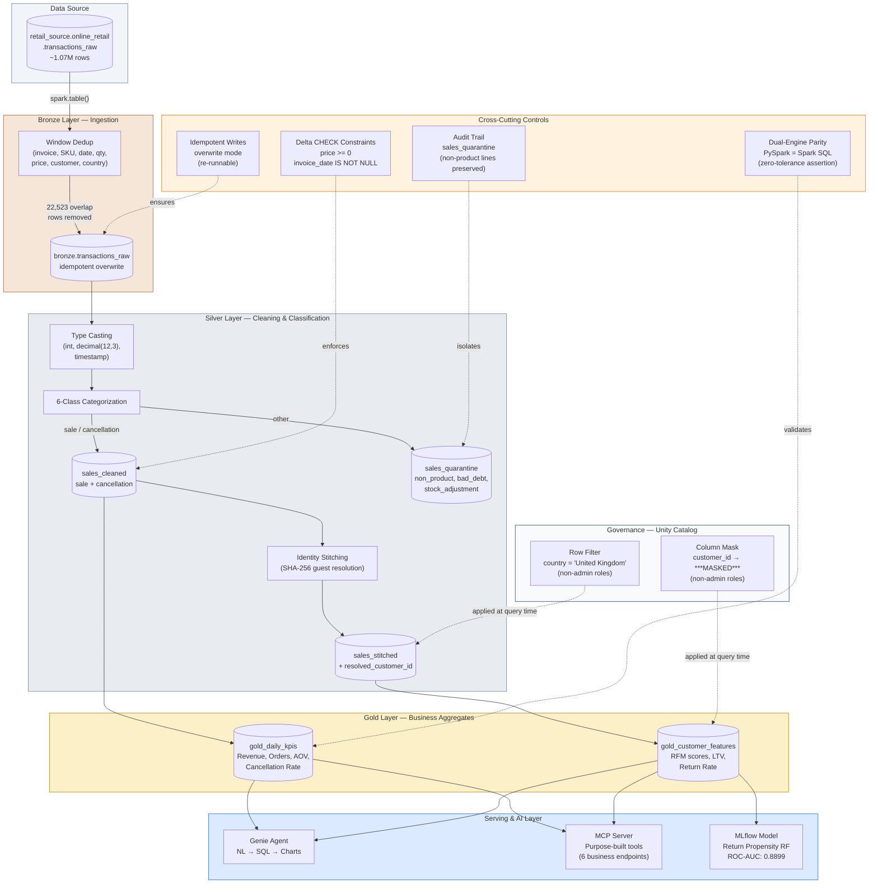
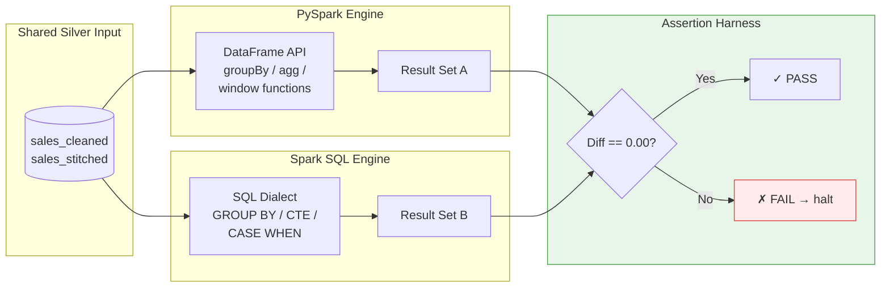
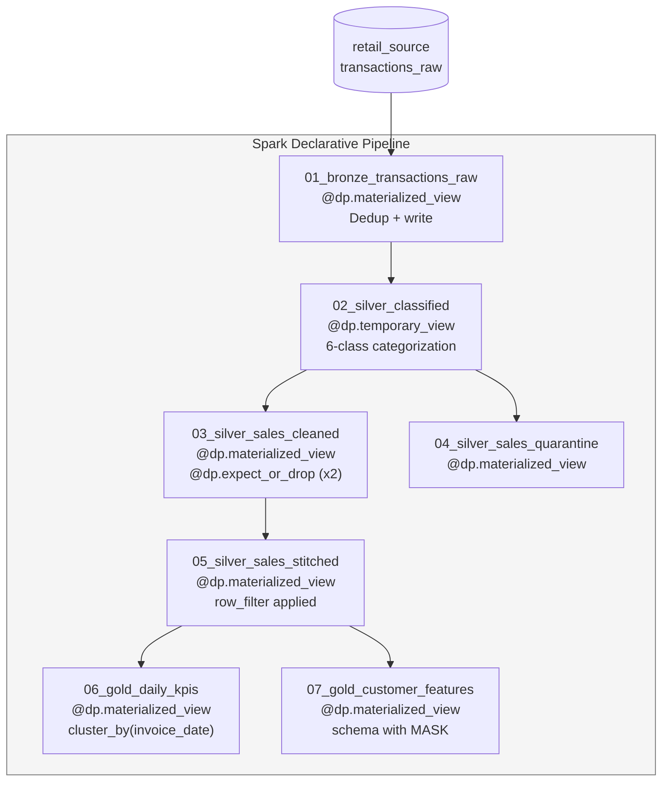

# System Architecture — Annotated Diagram

Layer colours follow the medallion tokens in [`design/tokens.json`](../design/tokens.json): Bronze copper, Silver slate, Gold yellow, Serving blue.

This document provides a detailed, annotated view of the EDA Retail Lakehouse architecture. For a quick overview, see the diagram in the main [README](../README.md).

---

## End-to-End Data Flow

---

## Dual-Engine Parity Architecture

The core trust mechanism: every critical metric is computed independently in two engines and compared with zero tolerance.

---

## Declarative Pipeline (SDP) Variant

The same medallion logic is implemented as a Spark Declarative Pipeline with materialized views and expectations:

---

## Component Boundaries & Ownership

| Layer | Components | Owned By | SLA Expectation |
|:---|:---|:---|:---|
| **Source** | UC source table | Data provider / upstream | Freshness per upstream SLA |
| **Bronze** | `bronze.transactions_raw` | Data Engineering | Near real-time (SDP) or batch (job) |
| **Silver** | `sales_cleaned`, `sales_quarantine`, `sales_stitched` | Data Engineering + Data Quality | Batch (daily/hourly) |
| **Gold** | `gold_daily_kpis`, `gold_customer_features` | Analytics Engineering | Batch, pre-aggregated |
| **Governance** | UC masks, row filters | Security / Governance | Enforced at query time |
| **ML** | `return_propensity_model` | ML Engineering | Batch scoring / on-demand |
| **Serving** | Genie, MCP Server | Platform / AI Engineering | Interactive (sub-second) |
